# ajolotito

A new Flutter project.

## Ronda 2. El reloj y el ajolote

### Objetivo

Implementar la lógica de una mascota virtual cuya
saciedad disminuye con el paso del tiempo, utilizando
la metodología de Desarrollo Guiado por Pruebas (TDD).

### Archivos desarrollados

- `lib/dominio/reloj.dart`
- `lib/dominio/mascota.dart`
- `test/mascota_test.dart`

### Funcionalidades implementadas

- Crear una mascota con 100 puntos de saciedad.
- Disminuir 10 puntos de saciedad por hora.
- Evitar que la saciedad sea menor que cero.
- Identificar los estados feliz, hambriento y famélico.
- Predecir cuándo tendrá hambre.
- Alimentar a la mascota con 35 puntos.
- Evitar alimentarla cuando ya está llena.
- Modificar el ritmo de hambre.
- Guardar y recuperar los datos mediante JSON.
- Validar datos incorrectos.

### Metodología TDD

#### Fase ROJA

Primero se escribió el archivo de pruebas
`mascota_test.dart` sin implementar la clase
`Mascota`, por lo que las pruebas fallaron.

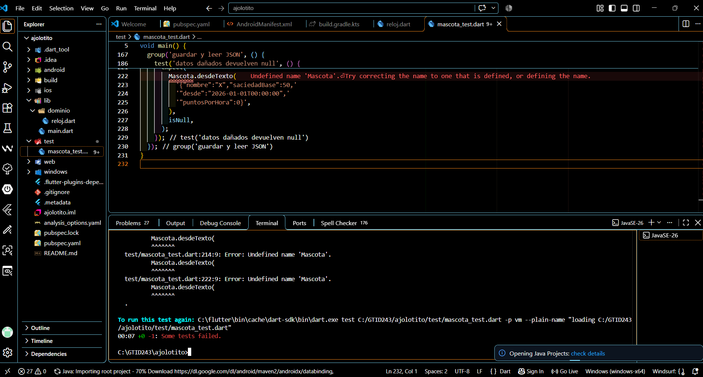

#### Fase VERDE

Después se implementó `mascota.dart`, con los
métodos y validaciones necesarios para superar
las pruebas automatizadas.

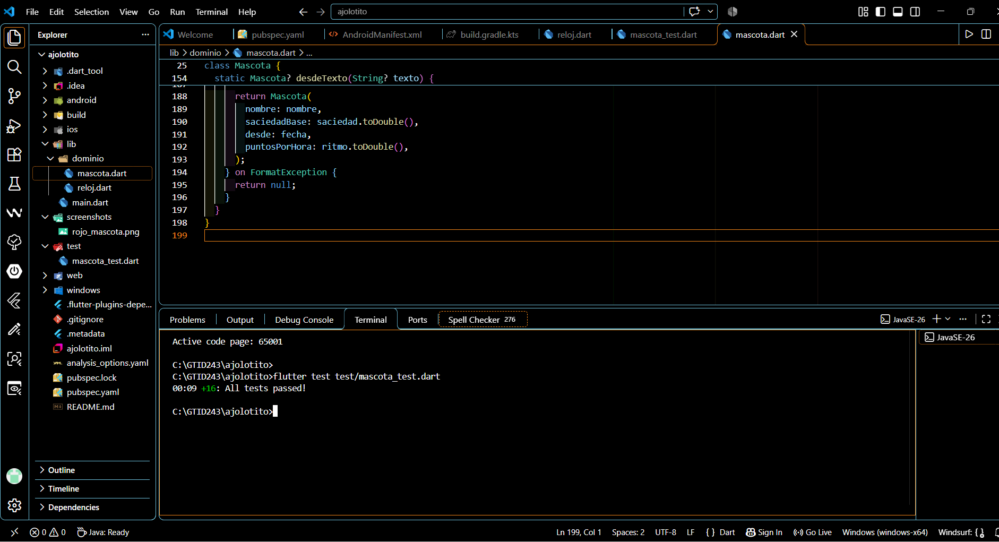

### Comando de pruebas

`flutter test test/mascota_test.dart`

### Resultado

Las pruebas automatizadas de la mascota se
ejecutaron correctamente.

La lógica de hambre y alimentación quedó
implementada y preparada para utilizarse
en las siguientes rondas.

## Ronda 3. Categorías y mensajes

### Objetivo

Organizar las notificaciones de Ajolotito Hambriento
mediante categorías y mensajes personalizados.

### Archivos desarrollados

- `lib/dominio/categoria.dart`
- `lib/dominio/mensajes.dart`

### Funcionalidades

Se crearon dos categorías de notificaciones:

- Hambre: notificaciones de importancia alta.
- Sorpresa: notificaciones de importancia baja.

También se implementaron mensajes personalizados
para los estados de hambre, hambre crítica y
sorpresas.

Los mensajes se seleccionan mediante una semilla
para obtener resultados predecibles.

## Ronda 4. Política de notificaciones

### Objetivo

Establecer reglas para enviar notificaciones
sin interrumpir los horarios de descanso
del usuario.

### Archivos desarrollados

- `lib/dominio/politica.dart`
- `test/politica_payload_test.dart`

### Funcionalidades

- Horas de silencio de 22:00 a 08:00.
- Ajuste automático de notificaciones nocturnas.
- Manejo correcto de cambios de día y mes.
- Configuración de categorías habilitadas.
- Definición de un máximo diario de avisos.
- Configuración de un margen entre notificaciones.

### Evidencia TDD

#### Prueba roja

Primero se escribieron las pruebas sin implementar
las clases necesarias.

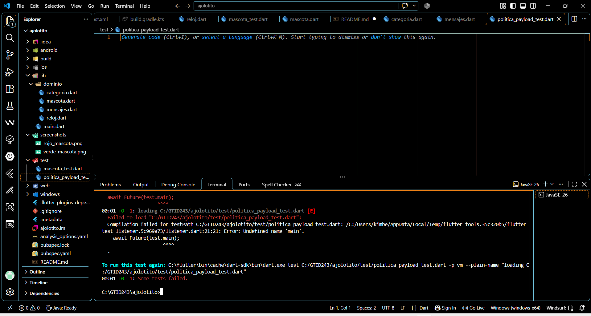

#### Prueba verde

Después se implementaron las reglas de la política
y la validación de los payloads.

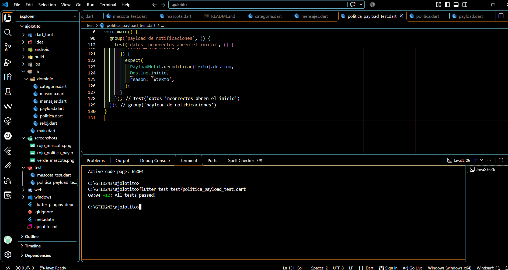

### Comando utilizado

`flutter test test/politica_payload_test.dart`

### Resultado

Las pruebas permitieron verificar las horas de
silencio y el ajuste de notificaciones.

## Ronda 5. Payload de notificaciones

### Objetivo

Implementar un mecanismo para identificar
qué pantalla debe abrirse al tocar una notificación.

### Archivo desarrollado

- `lib/dominio/payload.dart`

### Funcionalidades

Se definieron cuatro destinos:

1. Inicio.
2. Alimentar.
3. Alimentar inmediatamente.
4. Jugar.

Los payloads utilizan el formato versionado
`v1:destino`.

Cuando se recibe información incorrecta o
desconocida, la aplicación utiliza el destino
Inicio para evitar errores.

### Resultado

Se implementó la codificación y decodificación
segura de los destinos de notificación.

## Ronda 6. Planificador de notificaciones

### Objetivo

Implementar un planificador que calcule cuándo
deben enviarse las notificaciones de Ajolotito
Hambriento, respetando las preferencias del
usuario y evitando avisos duplicados.

### Archivos desarrollados

- `lib/dominio/planificador.dart`
- `test/planificador_test.dart`

### Funcionalidades implementadas

- Calcular cuándo el ajolote tendrá hambre.
- Programar avisos de hambre crítica.
- Programar sorpresas para los próximos tres días.
- Utilizar identificadores fijos para evitar duplicados.
- Respetar las horas de silencio de 22:00 a 08:00.
- Posponer las notificaciones nocturnas.
- Evitar avisos de hambre y hambre crítica demasiado cercanos.
- No programar avisos correspondientes a estados pasados.
- Respetar las categorías desactivadas.
- Limitar la cantidad diaria de notificaciones.
- Dar prioridad a los avisos más importantes.

### Metodología TDD

#### Fase ROJA

Primero se creó `planificador_test.dart` para
comprobar las reglas del planificador.

Las pruebas fallaron porque todavía no se había
implementado la clase Planificador.

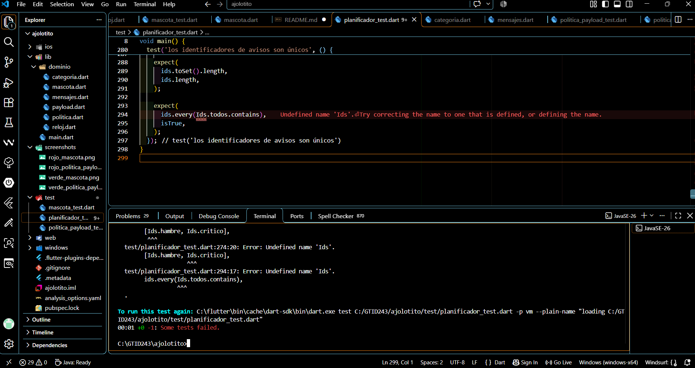

#### Fase VERDE

Después se implementó `planificador.dart`,
incluyendo los cálculos de fechas, horarios,
prioridades y límites de notificaciones.

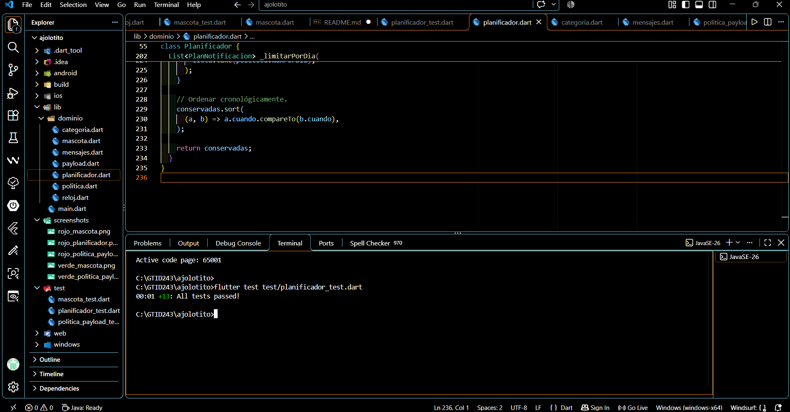

### Comando utilizado

`flutter test test/planificador_test.dart`

### Resultado

Las pruebas automatizadas del planificador
se ejecutaron correctamente.

Se comprobó que las notificaciones se calculan
según el estado de la mascota, respetando
los horarios de descanso y las preferencias
del usuario.

## Ronda 7. El puerto de notificaciones

### Objetivo

Separar la lógica de Ajolotito Hambriento
de los plugins de notificaciones del dispositivo.

### Archivos desarrollados

- `lib/dominio/puerto.dart`
- `test/falsos.dart`

### Funcionalidades implementadas

Se creó una interfaz llamada PuertoNotificaciones
que define las operaciones necesarias para:

- Inicializar las notificaciones.
- Consultar si están habilitadas.
- Solicitar permiso al usuario.
- Programar notificaciones.
- Mostrar avisos inmediatamente.
- Cancelar notificaciones.
- Detectar cuándo el usuario toca un aviso.
- Abrir los ajustes del dispositivo.

También se implementó PuertoFalso, que permite
simular estas operaciones sin utilizar un
teléfono o emulador real.

### Resultado

La lógica de notificaciones quedó separada
de su implementación en Android, facilitando
las pruebas automatizadas.

## Ronda 8. Permisos de notificaciones

### Objetivo

Implementar un mecanismo para solicitar
permisos de notificaciones de manera respetuosa,
sin insistir cuando el usuario los rechaza.

### Archivos desarrollados

- `lib/dominio/almacen.dart`
- `lib/dominio/gestor_permiso.dart`
- `test/permiso_test.dart`

### Funcionalidades implementadas

- Identificar si nunca se ha solicitado permiso.
- Reconocer cuando el permiso está concedido.
- Solicitar autorización solamente una vez.
- Evitar repetir el diálogo si el usuario rechaza.
- Permitir activar las notificaciones desde Ajustes.
- Almacenar la respuesta del usuario.
- Mantener la aplicación funcional sin notificaciones.

### Metodología TDD

#### Fase ROJA

Primero se crearon las pruebas automatizadas
sin implementar las clases necesarias.

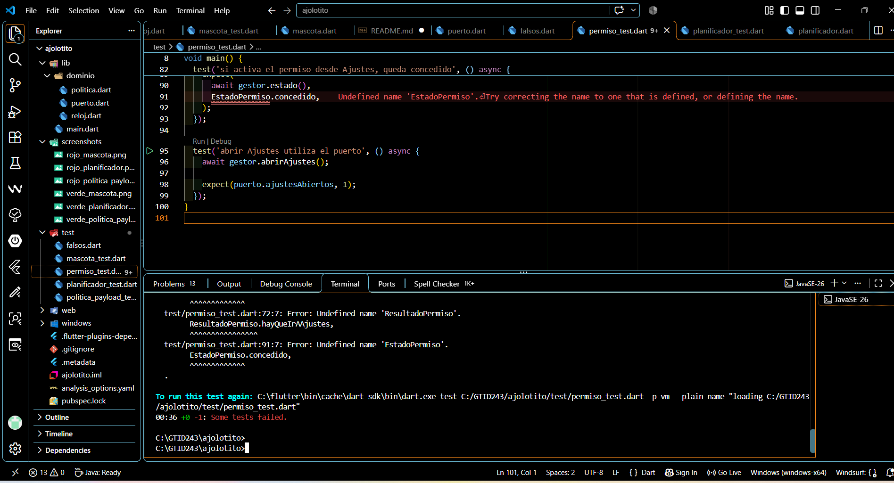

#### Fase VERDE

Posteriormente se implementaron AlmacenMemoria
y GestorPermiso para comprobar el comportamiento
de los permisos.

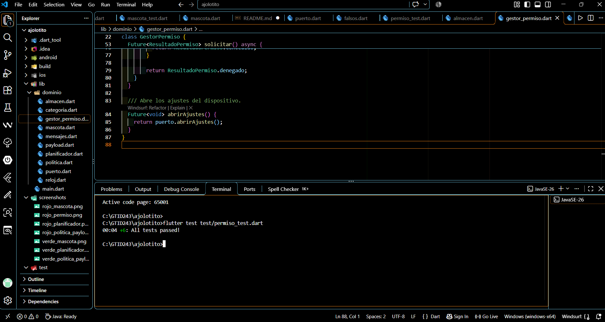

### Comando utilizado

`flutter test test/permiso_test.dart`

### Resultado

Las seis pruebas automatizadas del gestor
de permisos se ejecutaron correctamente.

Se comprobó que el usuario mantiene el control
sobre las notificaciones y que la aplicación
no solicita permisos repetidamente.

## Ronda 9. El servicio del ajolote

### Objetivo

Implementar un servicio que permita administrar
el estado de la mascota y mantener sincronizadas
sus notificaciones, respetando los permisos
y las preferencias del usuario.

### Archivos desarrollados

- `lib/dominio/servicio.dart`
- `test/servicio_test.dart`

### Funcionalidades implementadas

- Crear una mascota cuando se inicia por primera vez.
- Guardar y recuperar los datos del ajolote.
- Sincronizar las notificaciones programadas.
- Cancelar los avisos cuando no existe permiso.
- Evitar notificaciones duplicadas.
- Actualizar los avisos después de alimentar al ajolote.
- Respetar las categorías de notificaciones desactivadas.
- Diferenciar entre primer plano y segundo plano.
- Implementar el modo clase con tiempo acelerado.
- Identificar la pantalla que debe abrirse al tocar un aviso.
- Permitir generar una notificación inmediata de prueba.

### Metodología TDD

#### Fase ROJA

Primero se creó el archivo `servicio_test.dart`
con las pruebas de sincronización, alimentación,
permisos y notificaciones.

Las pruebas fallaron porque todavía no existía
la implementación de ServicioAjolote.

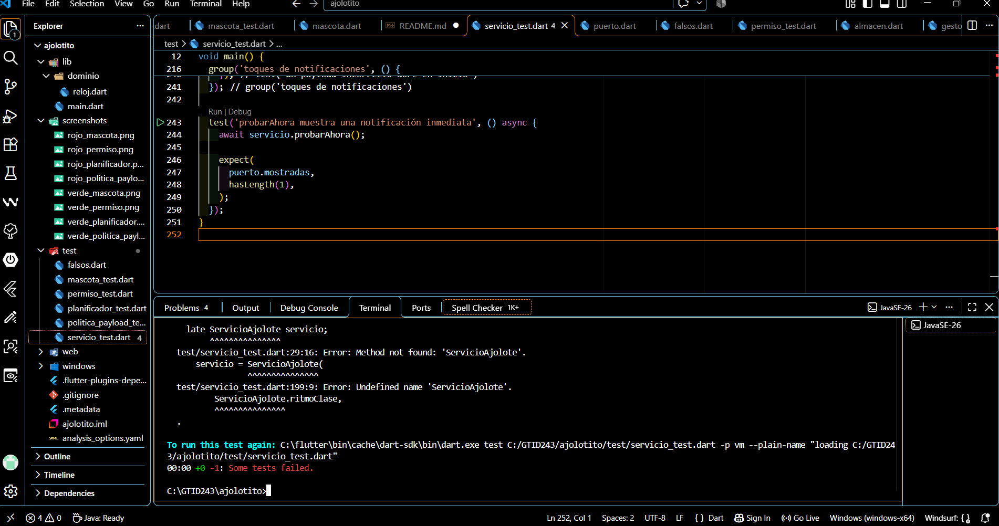

#### Fase VERDE

Posteriormente se implementó `servicio.dart`,
integrando las clases desarrolladas en las
rondas anteriores.

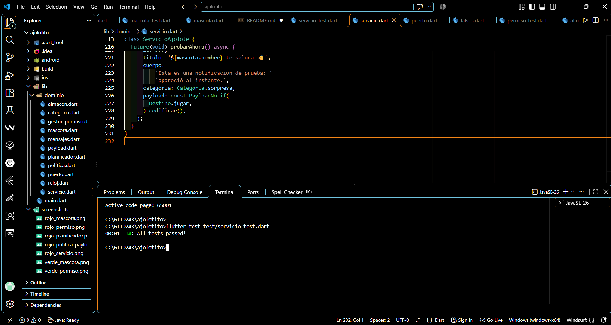

### Comando utilizado

`flutter test test/servicio_test.dart`

### Resultado

Las pruebas automatizadas del servicio
se ejecutaron correctamente.

Se verificó que las notificaciones se actualizan
cuando cambia el estado de la mascota, evitando
avisos repetidos u obsoletos.

También se comprobó que los recordatorios de
hambre se programan cuando la aplicación
pasa a segundo plano.

### Conclusión

La implementación de ServicioAjolote permitió
integrar la lógica de la mascota, el reloj,
las preferencias y el planificador.

Esta estructura facilita la conexión posterior
con las notificaciones reales de Android.

## Ronda 11. ViewModel, pantallas y arranque

### Objetivo

Desarrollar la interfaz gráfica de Ajolotito Hambriento
y conectar las pantallas con la lógica de la mascota,
los permisos y las notificaciones.

### Archivos desarrollados

- `lib/presentacion/ajolote_vm.dart`
- `lib/presentacion/dibujo_ajolote.dart`
- `lib/presentacion/pantalla_ajolote.dart`
- `lib/presentacion/pantalla_ajustes.dart`
- `lib/app.dart`
- `lib/main.dart`
- `test/vm_test.dart`
- `test/pantalla_test.dart`

### Funcionalidades implementadas

- Visualización del ajolote con diferentes expresiones.
- Representación de los estados feliz, hambriento y famélico.
- Barra que muestra el nivel de saciedad.
- Botón para alimentar a la mascota.
- Actualización de la información de la mascota.
- Solicitud de permisos con una explicación previa.
- Configuración de las categorías de notificaciones.
- Activación del modo clase para acelerar el tiempo.
- Detección de cambios entre primer y segundo plano.
- Apertura de la aplicación desde una notificación.
- Almacenamiento de las preferencias del usuario.

### Metodología TDD

#### Fase VERDE: Pruebas del ViewModel

Se implementó AjoloteViewModel para conectar
los componentes de la aplicación.

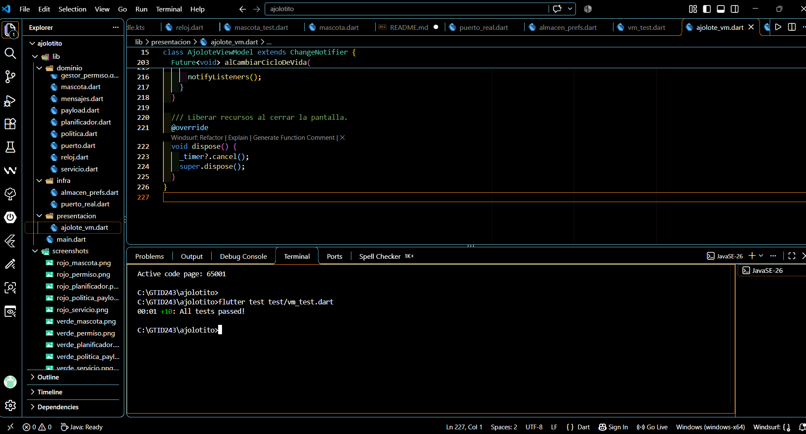

#### Fase ROJA: Pruebas de la pantalla

Se crearon pruebas para verificar los elementos
visuales y la solicitud de permisos.

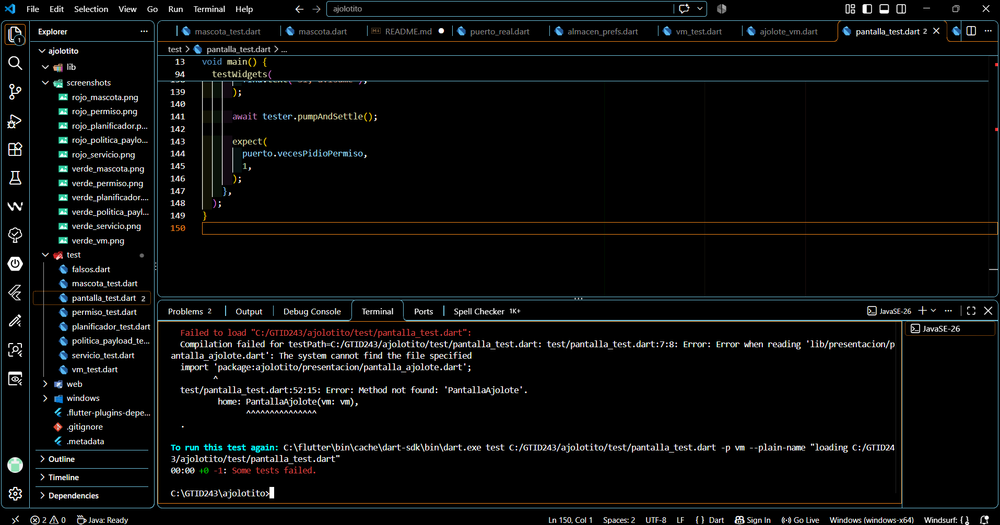

#### Fase VERDE: Pruebas de la pantalla

Se implementaron las pantallas y los componentes
visuales necesarios para superar las pruebas.

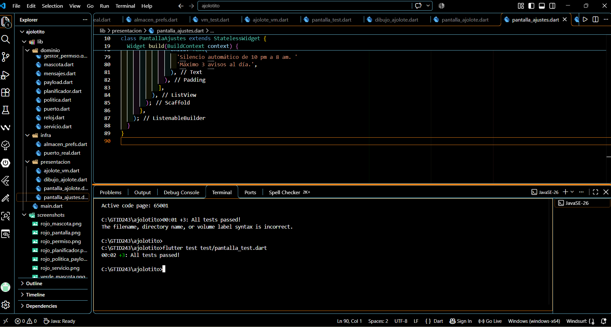

### Comandos utilizados

Pruebas del ViewModel:

`flutter test test/vm_test.dart`

Pruebas de la pantalla:

`flutter test test/pantalla_test.dart`

Pruebas generales:

`flutter test`

### Resultado

Se desarrollaron los componentes principales de
la interfaz de Ajolotito Hambriento y se integraron
con la lógica de la mascota.

Las pruebas automatizadas permitieron verificar
el comportamiento de los botones, los permisos,
las notificaciones y la alimentación.

### Evidencia de las pruebas generales

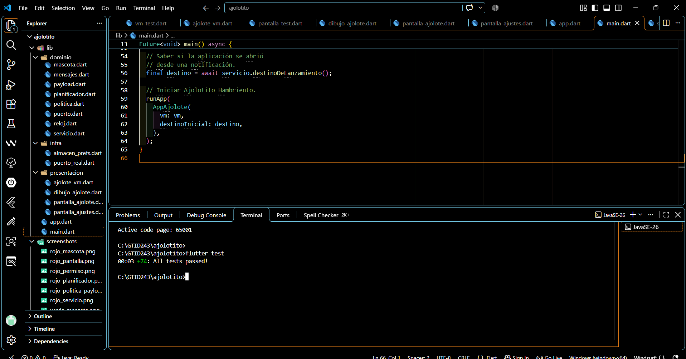

### Conclusión

La Ronda 11 permitió integrar el dominio,
los servicios, el almacenamiento y la interfaz
gráfica de la aplicación.

Con esta implementación, Ajolotito Hambriento
queda preparado para realizar pruebas de
funcionamiento en un dispositivo Android.

## Ejecución de Ajolotito Hambriento

### Prueba de funcionamiento en Microsoft Edge

Se ejecutó la aplicación mediante el comando:

`flutter run -d edge`

La aplicación abrió correctamente en el navegador,
mostrando la interfaz principal de Ajolotito Hambriento.

### Evidencia de ejecución

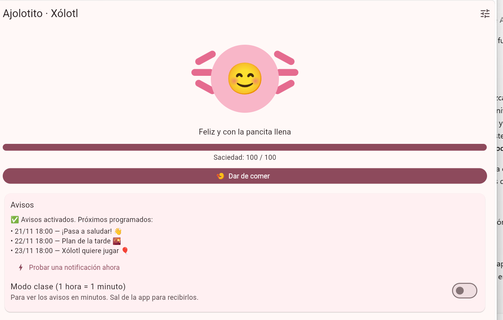

### Observaciones

La versión web permite visualizar y probar la
interfaz de la mascota.

Las notificaciones locales del dispositivo
quedan pendientes de comprobar en Android.

### Prueba 2. Alimentación del ajolote

Se utilizó el botón "Dar de comer" cuando
la mascota tenía hambre.

Se comprobó que su nivel de saciedad aumentó
y que su estado de ánimo cambió después
de alimentarla.

**Evidencia:**

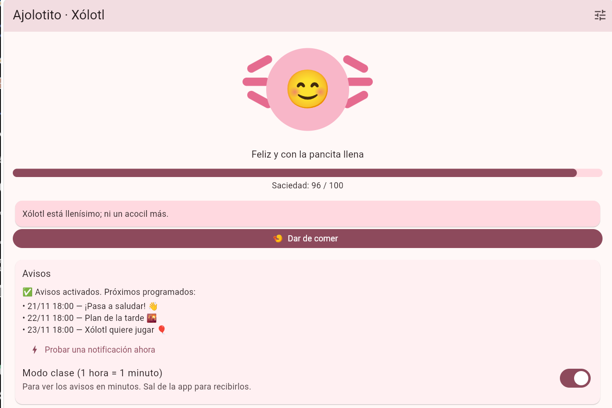
